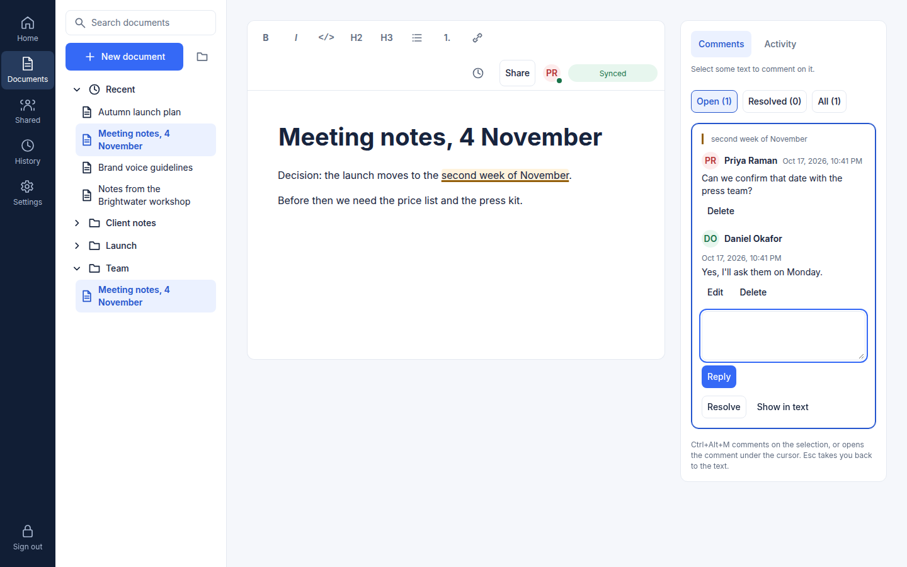
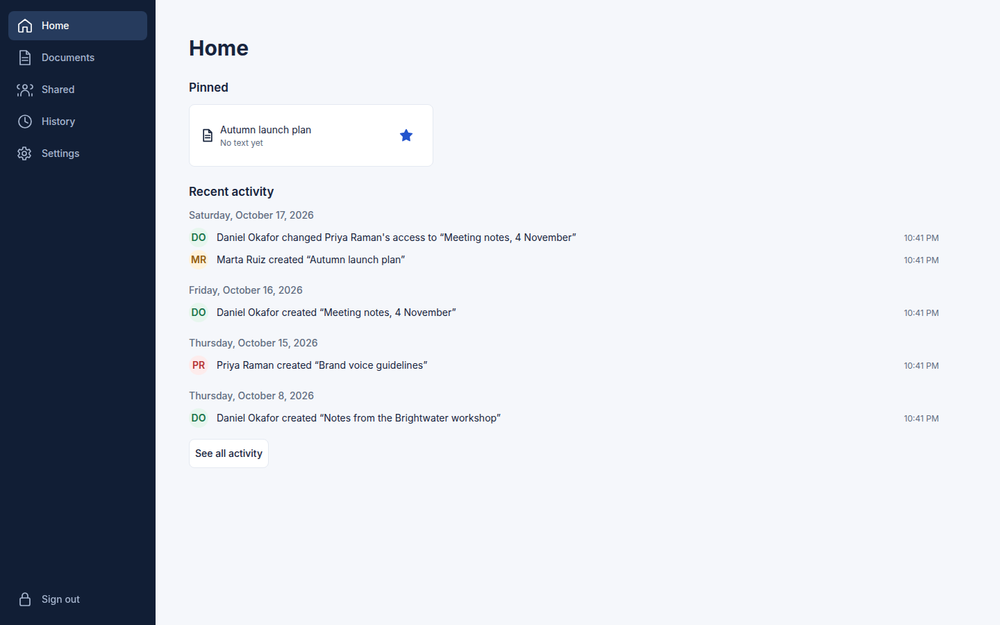
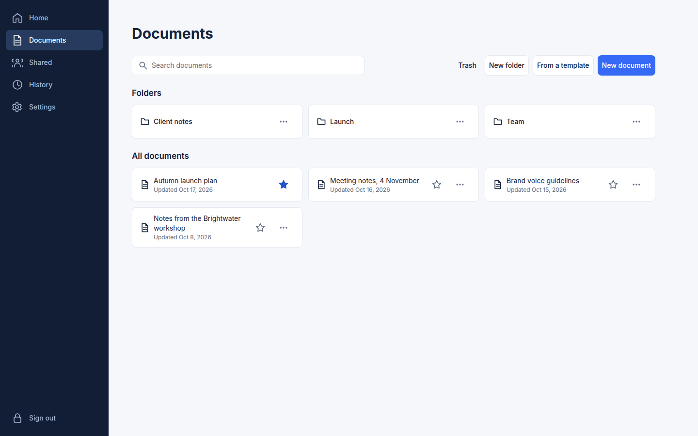
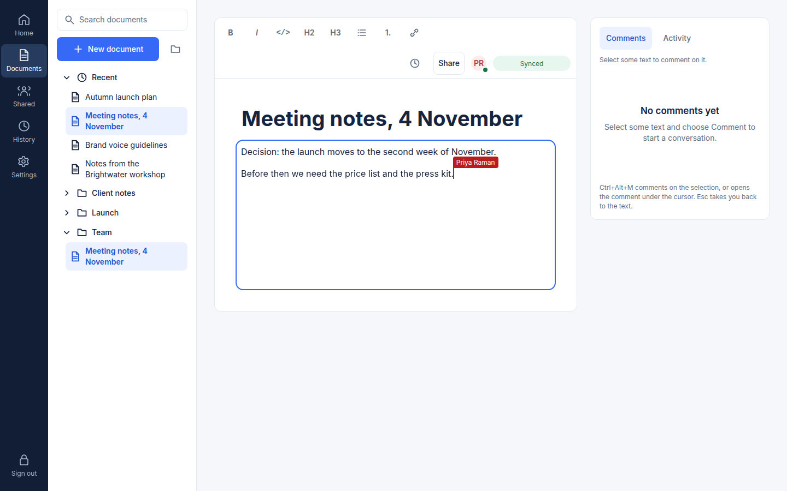
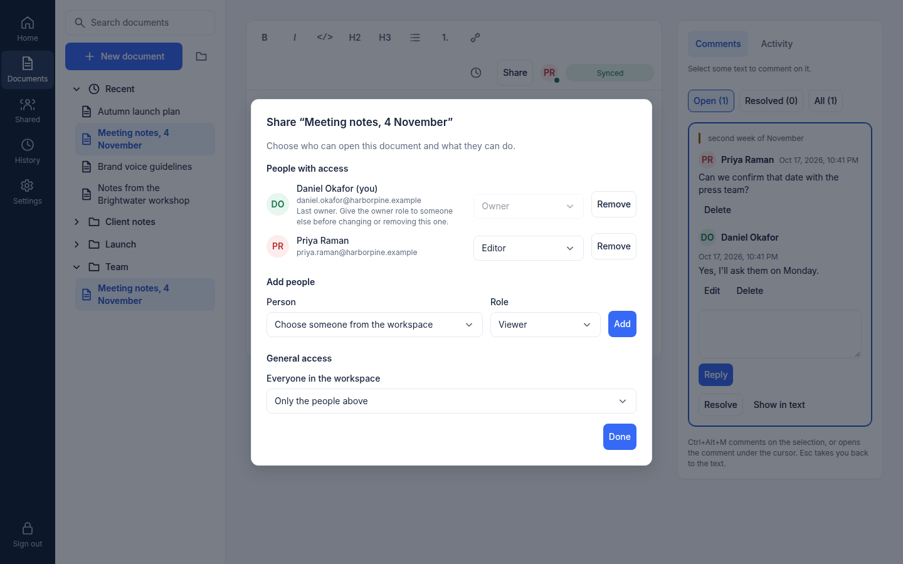
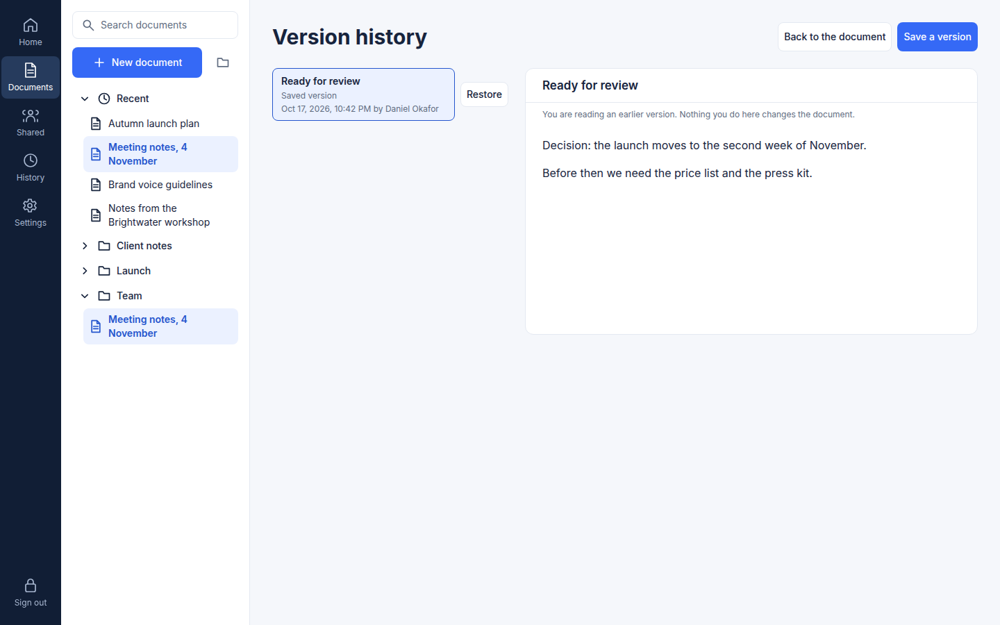
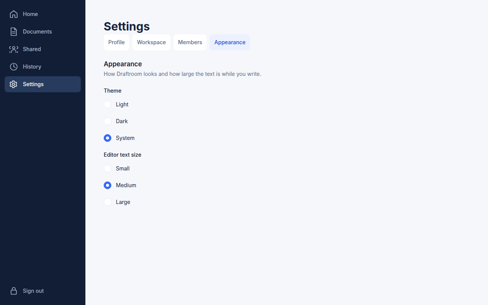
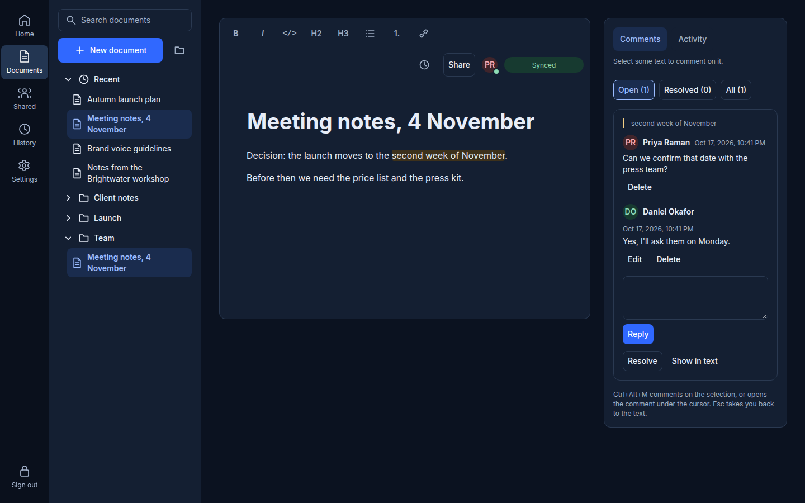
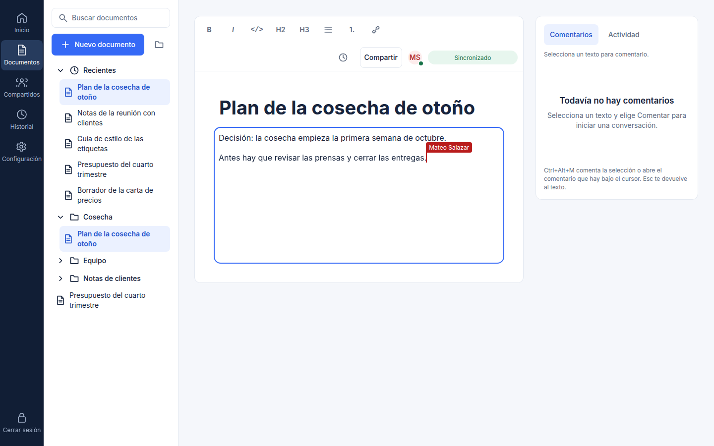

# Draftroom

**English** · [Español](README.es.md)

A collaborative document editor. People write in the same document at once and see each other's cursors; share it by role; come back to any earlier version; and keep working when the connection drops. Desktop-first (from 1280 px), in English and Spanish, with light and dark themes.

It is a portfolio project, built to be read as much as it is used: a real server and database, a real-time editor, and the decisions behind them written down ([architecture](docs/architecture.md), [decision records](docs/decisions/)).

## Tour



<video src="docs/assets/tour.webm" controls muted width="720"></video>

[A short clip](docs/assets/tour.webm): two people write in the same document and one comments on a sentence; the other sees the comment arrive. Recorded from one of the two browsers, against the real server.

| | |
| --- | --- |
|  **Home**: pinned documents and recent activity. |  **Documents**: folders and what changed. |
|  **Editor**: the other person's cursor, and "Synced" only once stored. |  **Sharing**: roles per person and for the workspace. |
|  **History**: preview a version before restoring it. |  **Settings**: profile, workspace, members, appearance. |
|  **Dark theme.** |  **Spanish**, in another workspace. |

These pictures and the clip are taken from the real stack by a script (`npm run docs:tour`, see [`scripts/readme-tour`](scripts/readme-tour/run.ts)), with the accounts of the demo seed.

## What it does

- **Write together.** Several people edit one document; changes merge without conflicts (Yjs), and the others' cursors and names are shown.
- **"Synced" means stored.** The editor says a change is synced only after the server confirms it wrote it to the database, never because the local copy changed. See [how that works](docs/architecture.md#synced-means-stored).
- **Keep working offline.** A document you have opened keeps a copy in the browser; edits made offline are sent when you reconnect, and signing out warns you before it would throw away changes the server never stored.
- **Comment on the text.** Select a sentence and comment on it with the mouse or with Ctrl+Alt+M (⌘⌥M on a Mac); threads stay attached to their text as others edit, can be answered, resolved and reopened, and work from the keyboard alone.
- **Organise.** An explorer with folders, search, pinned documents, templates, a trash with restore, and a view of what others shared with you.
- **Share by role.** Viewer, commenter, editor or owner, per person or for the whole workspace. The server enforces it for the API and for the live connection alike; taking access away closes the person's open connection.
- **History.** Automatic and named versions of every document that you can preview and restore, and an activity feed.
- **Settings.** Profile, workspace, members and appearance (light, dark or the system's; text size).
- **Two languages.** Every string exists in English and Spanish; dates and numbers follow the language.

## What it does not do

- It is not a mobile app: below 1280 px wide it asks for a larger window.
- It does not send email, so there are no invitations by email, no password recovery and no email verification ([Known limitations](#known-limitations)).
- It does not scale a document across several server processes: one process serves a document ([why](docs/deploy/README.md)).
- The static demo is not the product: see the next section.

## Static demo

The repository can build a demo that runs entirely in the browser, with no server (`npm run build:demo -w @draftroom/web`). **Everything in it is simulated in the browser:** the data is in memory and resets when the page reloads, the second person who writes is a script, and tabs of the same browser share a document to stand in for other people. It is meant for a quick look; it is not evidence that the server works. Nothing is published from this repository yet.

## Stack

| Layer | What it uses |
| --- | --- |
| Client | React 19.3, TypeScript 6.0, Vite 8.3, React Router 8.4, TanStack Query 5.104, react-intl 12.1 |
| Editor | Tiptap 3.31 over Yjs 13.6, with a Hocuspocus provider 4.7 and `y-indexeddb` for the offline copy |
| Components | [Forma UI](https://github.com/Yelison/forma-ui) 0.6 for components and design tokens |
| Server | Node.js 24, Fastify 5.12 (REST), Hocuspocus 4.7 (collaboration WebSocket), Kysely 0.29 and `pg` |
| Database | PostgreSQL 17: rows for the data, the binary Yjs state for each document's content |
| Contract | OpenAPI 3.1 ([`packages/contract`](packages/contract/openapi.yaml)) with generated types, and a [collaboration protocol](docs/collab/protocol.md) |
| Quality | Vitest 5, Playwright 1.64, oxlint, Prettier |
| Deployment | Docker Compose with Caddy for HTTPS and WebSocket proxying |

How the pieces fit, with the data flow of an edit, is in [docs/architecture.md](docs/architecture.md).

## Run it for development

You need Node.js 24 (`.nvmrc`), npm 11 and, to run the real server, Docker with the Compose plugin.

```sh
npm ci
npm run dev -w @draftroom/web      # http://localhost:5173, with an in-memory API: no server needed
```

In development the app talks to the in-memory API (the same one the static demo uses), so the front end can be worked on alone. To run it against the real server and a database:

```sh
cp .env.example .env                                # development values; .env is ignored by git
sed -i 's|^ALLOWED_ORIGINS=.*|ALLOWED_ORIGINS=http://localhost:5173|' .env   # lets the server accept the browser's WebSocket
docker compose up -d --wait postgres                # PostgreSQL on 127.0.0.1:5460
npm run migrate -w @draftroom/server                # create the schema
npm run seed:demo -w @draftroom/server              # the demo workspaces and accounts (development only)
npm run dev -w @draftroom/server                    # the API on :8380 and collaboration on :8480

# in another terminal: the app, sending /api and /collab to that server
VITE_DATA_SOURCE=http E2E_API_ORIGIN=http://127.0.0.1:8380 E2E_COLLAB_ORIGIN=http://127.0.0.1:8480 \
  npm run dev -w @draftroom/web
```

(`ALLOWED_ORIGINS` is the origin the browser opens the app from; without it the server refuses the WebSocket and the editor stays on its loading screen. The two `E2E_` variables carry the name of the test suite that introduced them: with both set, the dev server forwards `/api` and `/collab` as a reverse proxy does in production.) Sign in as `daniel.okafor@harborpine.example` with the password `harbor pine rooftop`; the other demo accounts, all in [`apps/server/src/db/demo-seed/content.ts`](apps/server/src/db/demo-seed/content.ts), share it. The seed refuses to run outside development and test. More about the server and its scripts is in [CONTRIBUTING](CONTRIBUTING.md).

## Run it yourself

You need Docker with the Compose plugin and a host name that points at the machine (or `draftroom.localhost` to try it on one machine).

```sh
cp deploy/env.example deploy/.env       # then fill in the host name (`SITE_ADDRESS` and `PUBLIC_ORIGIN`) and the two secrets (empty until you do)
docker compose --env-file deploy/.env -f deploy/docker-compose.prod.yml -p draftroom-prod up -d --build --wait
```

The production project is called `draftroom-prod` and the development one `draftroom`, so that the two never share a database or its volume: with one name, the production database would start on the development data.

Caddy serves the app over HTTPS, the server migrates the database when it starts, and only the proxy publishes ports. Take a backup
with `scripts/backup.sh` and restore it with `scripts/restore.sh`. [The deployment guide](docs/deploy/README.md) covers running without
Docker, the reverse proxy and its WebSocket requirements, every variable, backups, and why a document is served by one process.

## How it is tested

| Suite | Command | What it covers |
| --- | --- | --- |
| Unit and component tests | `npm test` | The server's domain rules and the web app's components and logic, in Vitest. |
| Mocked end to end | `npm run test:e2e -w @draftroom/web` | The screens in a real browser against the in-memory API. |
| Server integration | `npm test -w @draftroom/server` | The API, the collaboration server and the migrations against PostgreSQL 17 started by Testcontainers (needs Docker). |
| Real stack end to end | `npm run test:e2e-collab -w @draftroom/web` | Two browsers against the real server and database: convergence, durability when the server is killed, revocation, the production build. Needs PostgreSQL running, as above. |
| Static demo | `npm run test:e2e-demo -w @draftroom/web` | The demo build, which must not reach the network. |

The CI runs four required checks on every pull request: **Static checks** (lint, format, type check, the OpenAPI lint and generated types, and `npm test`), **Web e2e (mocked API)**, **Server integration (PostgreSQL)** and **Collaboration e2e (real stack)**. A dependency audit runs on every pull request too; a backup-and-restore drill and a build of the static demo run only when the pull request touches what they cover. None of these is required.

`npm run docs:links` fails when a relative link in the READMEs or the architecture document points at a file that does not exist.

## Repository

```text
apps/server            REST (Fastify) and collaboration (Hocuspocus) in one process, migrations, the demo seed
apps/web               the React app, its in-memory API, and the browser test suites
packages/contract      the OpenAPI contract, its generated types and the collaboration message schemas
packages/editor-schema the editor's schema, shared by the client and the server
deploy                 Compose file, Caddy configuration and the backup-and-restore drill
docs                   architecture, decision records, API and collaboration protocol, deployment guide
scripts                backup and restore, the README tour, the link check
```

## Known limitations

- **Email addresses are not verified at sign-up.** Whoever signs up first with an address that has a pending invitation inherits what was shared with it, and the sign-up answer tells which addresses have an account. Closing it needs a verification link and email delivery in both languages; see [ADR 0004](docs/decisions/0004-authentication.md#known-risk-no-email-verification).
- **No email at all.** There are no invitation emails, no password recovery, no way to change a password and no list of sessions: each of them needs email delivery or its own task ([ADR 0004](docs/decisions/0004-authentication.md)).
- **One workspace at a time.** The app works in the first of a person's workspaces, by name, and has no way to choose another yet.
- **One server process.** A document lives in the memory of one process, so the stack does not run replicas; the limits on sign-in attempts live in that process's memory and reset when it restarts ([deployment guide](docs/deploy/README.md#what-is-not-done-yet)).
- **Two people typing at once at the same point of an empty document.** Their texts can end up next to each other in one paragraph, or in two paragraphs in either order. Both see the same thing and it is what is stored: it is what happens when two people write in the same place at the same time.
- **Offline editing needs a first visit.** A document you never opened on this device has no local copy and cannot be edited offline.
- **Desktop only.** From 1280 px wide; narrower windows are asked to widen.

## License

[MIT](LICENSE)
