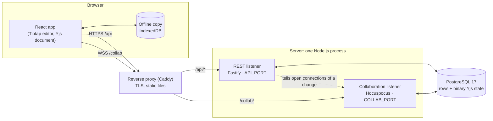
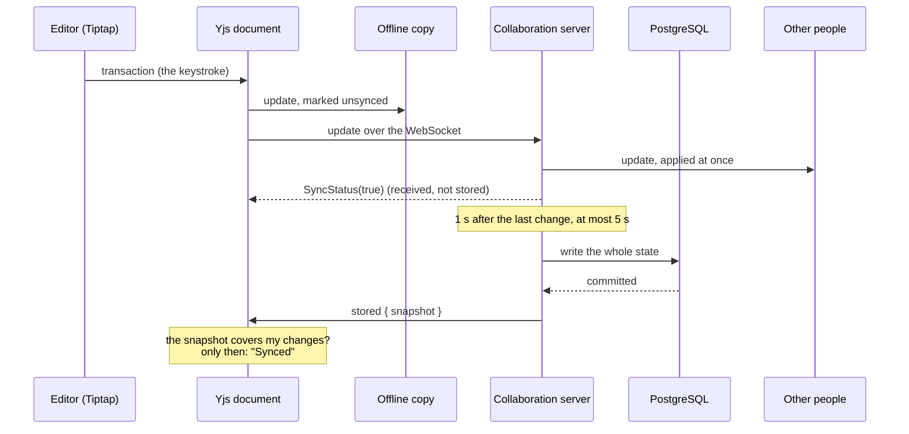

# Architecture

How Draftroom is put together, and why the parts that matter are the way they are. Every claim below points at the file that makes it true or at the decision that explains it; the [collaboration protocol](collab/protocol.md) and the [REST contract](api/README.md) are the normative references for the wire.

## The shape of the system

One browser app, one server process with two listeners, one PostgreSQL. In production a reverse proxy is the only thing the outside world reaches.

- **One process, two listeners.** REST on `API_PORT` and the collaboration WebSocket on `COLLAB_PORT` start together in [`apps/server/src/main.ts`](../apps/server/src/main.ts). They share the database pool and call each other in process: a route that changes who may open a document closes the connections it just made illegal ([ADR 0012](decisions/0012-access-and-revocation.md)), and the collaboration server logs through the REST app.
- **A document is served by one process.** Hocuspocus keeps the live document in memory, so two server instances would each hold a copy and diverge. The [deployment guide](deploy/README.md) says how that limits scaling.
- **The proxy** sends `/api/*` and `/collab*` to the server and serves the built web app for everything else ([`deploy/Caddyfile`](../deploy/Caddyfile), [ADR 0016](decisions/0016-production-packaging.md)). In development the Vite dev server plays that part, and `vite preview` in the real-stack tests, when `E2E_API_ORIGIN` and `E2E_COLLAB_ORIGIN` are set ([`apps/web/vite.config.ts`](../apps/web/vite.config.ts)).
- **Two kinds of data, two homes.** Everything relational (workspaces, members, folders, document metadata, access, threads, versions, activity) lives in rows. The content of a document is a binary Yjs state in `document_states`, written only by the collaboration server ([ADR 0005](decisions/0005-data-model-and-permissions.md), [`stateStore.ts`](../apps/server/src/collab/stateStore.ts)). Content is never rebuilt from JSON.

## What happens when someone types

1. **Editor to Yjs.** The editor binds ProseMirror to a shared Yjs fragment ([`CollaborationExtensions.ts`](../apps/web/src/features/editor/CollaborationExtensions.ts)); the schema both sides agree on is [`packages/editor-schema`](../packages/editor-schema/README.md).
2. **Yjs to the socket.** One `HocuspocusProvider` per open document, one WebSocket per document ([protocol §2](collab/protocol.md#2-document-name), [`session.ts`](../apps/web/src/collab/session.ts)).
3. **The server applies and relays at once.** Everyone connected sees the change without waiting for the database. The server answers every update with an in-memory acknowledgement, which says nothing about storage ([protocol §1, F1](collab/protocol.md#1-facts-this-protocol-is-built-on)).
4. **The server stores after a debounce.** A write is made 1 s after the last change and at most 5 s after the first of a burst ([`STORE_DEBOUNCE_MS` and `STORE_MAX_DEBOUNCE_MS`](../packages/contract/src/collab.ts)). A failed write is retried with back-off, and the document stays loaded while it is unconfirmed ([protocol §7.2](collab/protocol.md#72-server)). Before it stores, the server checks the state with the schema's own reader and removes the top-level blocks the schema refuses ([`contentValidation.ts`](../apps/server/src/collab/contentValidation.ts), [ADR 0011](decisions/0011-collaboration-server.md)).
5. **The durable acknowledgement comes back.** See below.

## "Synced" means stored

The in-memory acknowledgement of step 3 arrives before the database write, so a server that crashed in the debounce window would lose changes the person had been told were safe. Draftroom therefore says "Synced" only on a **durable acknowledgement** ([ADR 0006](decisions/0006-collaboration-durability.md), [protocol §7](collab/protocol.md#7-durable-acknowledgement)):

- After every write that **committed**, the server sends writable connections a `stored` event carrying a snapshot of what it wrote ([`durableAck.ts`](../apps/server/src/collab/durableAck.ts)). A failed write sends nothing.
- A snapshot, not a state vector, because deleting text changes no clock: a vector cannot show that a deletion was stored ([protocol §1, F11](collab/protocol.md#1-facts-this-protocol-is-built-on)).
- The client keeps what it changed and has not seen stored as `pending`, and drops it only when a `stored` snapshot contains every part of it ([`PendingChanges.ts`](../apps/web/src/collab/PendingChanges.ts)). The states the screen can show, and when each follows, are a pure function in [`syncState.ts`](../apps/web/src/collab/syncState.ts).
- A reader receives no `stored` event and is shown "Read-only", never "Synced".
- A connection that opens with nothing new to send is told what is stored now, so a reopened document does not wait for a change that will never come ([`durableAck.ts`](../apps/server/src/collab/durableAck.ts), [protocol §7.3](collab/protocol.md#73-server-the-snapshot-a-new-connection-gets)).

The real-stack suite kills the server process without warning to check that what was said to be stored survives ([`durability.spec.ts`](../apps/web/e2e-collab/durability.spec.ts)).

## The offline copy

A document the person has opened keeps a copy in the browser's IndexedDB, one per account, workspace and document ([`offlineCache.ts`](../apps/web/src/collab/offlineCache.ts), [protocol §12](collab/protocol.md#12-offline-cache-and-revocation)). It is the person's working memory and is never called "saved": offline, the screen says it is working from a local copy.

- Each copy carries an `unsynced` marker set by the copy itself when the person changes something, and cleared only when a `stored` snapshot contains everything the copy holds ([ADR 0013](decisions/0013-offline-copy-marker.md)).
- **Signing out or switching account** checks the markers first and asks before it deletes changes the server never stored. **Losing access** deletes the copy without asking, because nothing may be sent after access is gone.
- A document never opened on this device has no copy, so it cannot be edited offline.

## Permissions are the server's

A read-only screen is not a barrier: every path to data decides on the server, with default deny.

- **The rules are a pure function** of facts a caller loads, with no database and no request ([`domain/permissions.ts`](../apps/server/src/domain/permissions.ts), [ADR 0005](decisions/0005-data-model-and-permissions.md), [ADR 0010](decisions/0010-server-authorisation.md)). Roles are viewer, commenter, editor and owner; a workspace owner owns every document of the workspace.
- **REST** finds the resource and the caller's right to read it (a `404`, the same answer for "missing" and "not yours"), then checks the role (a `403`), in that order, in one place for every route ([`http/authorise.ts`](../apps/server/src/http/authorise.ts)). The order is part of the [contract](api/README.md).
- **The WebSocket** repeats the decision when a connection is made: the same role rules choose between a read-write and a read-only connection ([`connectionMode.ts`](../apps/server/src/collab/connectionMode.ts), [`authenticate.ts`](../apps/server/src/collab/authenticate.ts), [protocol §3 and §4](collab/protocol.md#3-connection-and-authentication)). A read-only connection never applies an update, whatever it sends.
- **A change of access reaches open connections.** Once a change is committed, the connections it affects are re-checked and closed or switched to the new mode ([`revocation.ts`](../apps/server/src/collab/revocation.ts), [ADR 0012](decisions/0012-access-and-revocation.md)).
- **Who a person is** comes from a session cookie, with Argon2id passwords, a signed CSRF token and a limit on sign-in attempts ([ADR 0004](decisions/0004-authentication.md)). The collaboration socket reads the same cookie from the upgrade request, never a token in the address.

- **Hardening at the edges.** Each response has one owner for its security headers: the server for `/api` and the collaboration port, the proxy for the page and its files, and the build for a content security policy written into the page itself (with the hashes of the page's own scripts, and no `unsafe` script source). CORS and the WebSocket upgrade accept only the origins in `ALLOWED_ORIGINS`, requests are limited per address and per session, and `TRUST_PROXY` tells the server which proxy's word to take for a visitor's address ([ADR 0017](decisions/0017-http-hardening.md)). In production the session cookies carry the `__Host-` prefix ([ADR 0004](decisions/0004-authentication.md)).

## Comments anchored to text

A thread belongs to a range of the text, and the range has to follow the text as other people edit around it.

- The anchor is two Yjs **relative positions** plus the quoted text, stored as opaque values in the `threads` table, outside the Yjs document ([protocol §10](collab/protocol.md#10-comment-anchors), [migration 0003](../apps/server/src/db/migrations/0003_comments.ts)). The server validates their shape and never decodes them.
- A relative position names the characters it sits between, not a number, so it still resolves after edits before or inside the range. A thread whose text was deleted becomes an **orphan**: its card says the text was removed, and it keeps its conversation.
- **Highlights are drawn from Yjs.** An editor plugin resolves every open thread's anchor against the Yjs document and decorates the text ([`highlightPlugin.ts`](../apps/web/src/features/comments/highlightPlugin.ts), [`anchors.ts`](../apps/web/src/features/comments/anchors.ts)). The person's own typing is drawn from the editor's mapping first and corrected from Yjs a microtask later, so there is no lag and no second rule for where a thread is ([ADR 0018](decisions/0018-comment-highlights-keyboard-and-demo-anchors.md)).
- **The comment key works for everyone who can comment.** A commenter's text is not editable, and an editable view is the only one ProseMirror gives key events to through the usual route; the shortcut is therefore a DOM `keydown` handler that runs for every role ([ADR 0018](decisions/0018-comment-highlights-keyboard-and-demo-anchors.md)). From the keyboard alone a person can select, comment, reply, resolve and return to the text.
- Comments travel over REST, not through the document, so a commenter, who may not change content, can still comment ([ADR 0005](decisions/0005-data-model-and-permissions.md)). Who may edit or delete a comment is [`domain/comments.ts`](../apps/server/src/domain/comments.ts); the routes are [`http/routes/comments.ts`](../apps/server/src/http/routes/comments.ts), and the panel is [`features/comments`](../apps/web/src/features/comments/CollaborationPanel.tsx).
- In the static demo the threads are anchored in starting text that the mock writes as a fixed Yjs client, so the anchors resolve in every tab and reload ([ADR 0018](decisions/0018-comment-highlights-keyboard-and-demo-anchors.md)).

## Versions

A version is a full copy of the Yjs state at a moment, so it can be previewed and restored exactly ([ADR 0007](decisions/0007-versions-and-restore.md), [ADR 0014](decisions/0014-versions-and-restore-implementation.md)).

- A version is `auto` (made after ten minutes without edits, [`autoVersions.ts`](../apps/server/src/collab/autoVersions.ts)), `manual` (named by a person), or one of the two a restore leaves behind, `pre-restore` and `restore` ([migration 0004](../apps/server/src/db/migrations/0004_versions.ts)).
- A restore is one verified sequence under the same lock the store uses, so it cannot interleave with a write, and it keeps what it replaced as a version of its own ([protocol §11](collab/protocol.md#11-versions-and-restore)). The ADR says exactly what it can still lose.

## The `DataSource` boundary

Screens never call `fetch`. They ask a `DataSource`, an interface with one method per operation of the REST contract that the client calls, typed from the generated schema, so a change to [`openapi.yaml`](../packages/contract/openapi.yaml) breaks every implementation that no longer fits ([`DataSource.ts`](../apps/web/src/data/DataSource.ts), [`useDataSource.ts`](../apps/web/src/data/useDataSource.ts)).

| Implementation | Used by | Where |
| --- | --- | --- |
| HTTP | a production build, which talks to the real API and the collaboration server | [`data/http`](../apps/web/src/data/http/HttpDataSource.ts) |
| In-memory mock | development, the mocked end-to-end suite and the static demo | [`data/mock`](../apps/web/src/data/mock/README.md) |

The choice is made when the app is built ([`select.ts`](../apps/web/src/data/select.ts), `VITE_DATA_SOURCE`), and the branch not chosen is removed from the bundle; a test fails if any trace of the mock is left in a production build ([`production-bundle.spec.ts`](../apps/web/e2e/production-bundle.spec.ts)).

The mock's answers are validated against the OpenAPI schemas in the tests, and one behaviour suite runs against both the mock and the real server ([`contract.suite.ts`](../apps/web/src/data/contract.suite.ts)), so the screens that were built on the mock work on the server. Its permission rules are a simulation to give screens believable answers, not proof of anything: authorisation is the server's.

In the static demo, collaboration is simulated in the browser: a scripted second person writes, and tabs of the same browser share a document ([`data/mock/collab`](../apps/web/src/data/mock/collab/demo.ts)). No server is involved.

## Decisions

| ADR | Decides |
| --- | --- |
| [0001](decisions/0001-architecture-and-stack.md) | The overall architecture and the stack: Yjs for content, PostgreSQL for the rest, one server process. |
| [0002](decisions/0002-adopt-forma-ui.md) | Use Forma UI for components and tokens, consumed like any other application would. |
| [0003](decisions/0003-internationalisation.md) | English and Spanish with ICU messages, one pair of catalogues, no translated content. |
| [0004](decisions/0004-authentication.md) | Passwords, sessions, CSRF and the limit on attempts. |
| [0005](decisions/0005-data-model-and-permissions.md) | Which datum lives where, and the roles that gate every path to it. |
| [0006](decisions/0006-collaboration-durability.md) | "Synced" means stored: a durable acknowledgement built on a snapshot. |
| [0007](decisions/0007-versions-and-restore.md) | Versions are full Yjs updates; restore is one verified transaction. |
| [0008](decisions/0008-product-tokens.md) | Product-specific design tokens live in a generated file. |
| [0009](decisions/0009-server-runtime-and-database.md) | The server runs its TypeScript directly on Node, and reaches the database with Kysely. |
| [0010](decisions/0010-server-authorisation.md) | The roles as a pure function, the development identity and the order of the checks. |
| [0011](decisions/0011-collaboration-server.md) | What the collaboration server may store, and how the position-migration map grows. |
| [0012](decisions/0012-access-and-revocation.md) | Changing access closes connections: the role at the moment of writing, then "commit, then close". |
| [0013](decisions/0013-offline-copy-marker.md) | The unsynced marker belongs to the copy and decides what is pending when it is opened. |
| [0014](decisions/0014-versions-and-restore-implementation.md) | How versions and restore were built on the server, and what they can still lose. |
| [0015](decisions/0015-real-stack-e2e-identity.md) | Who a browser was in the real-stack suite before sessions (superseded by 0004). |
| [0016](decisions/0016-production-packaging.md) | Who serves the web app, how the database is migrated and how it is backed up. |
| [0017](decisions/0017-http-hardening.md) | Who sets which header, CORS, request limits and the trusted proxy. |
| [0018](decisions/0018-comment-highlights-keyboard-and-demo-anchors.md) | Comment highlights drawn from Yjs, the key that comments for every role, and the demo's starting text. |
