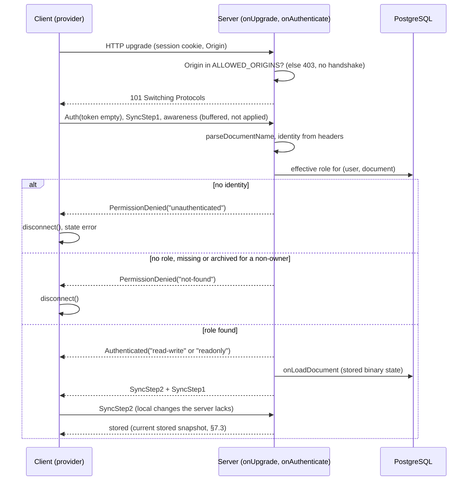
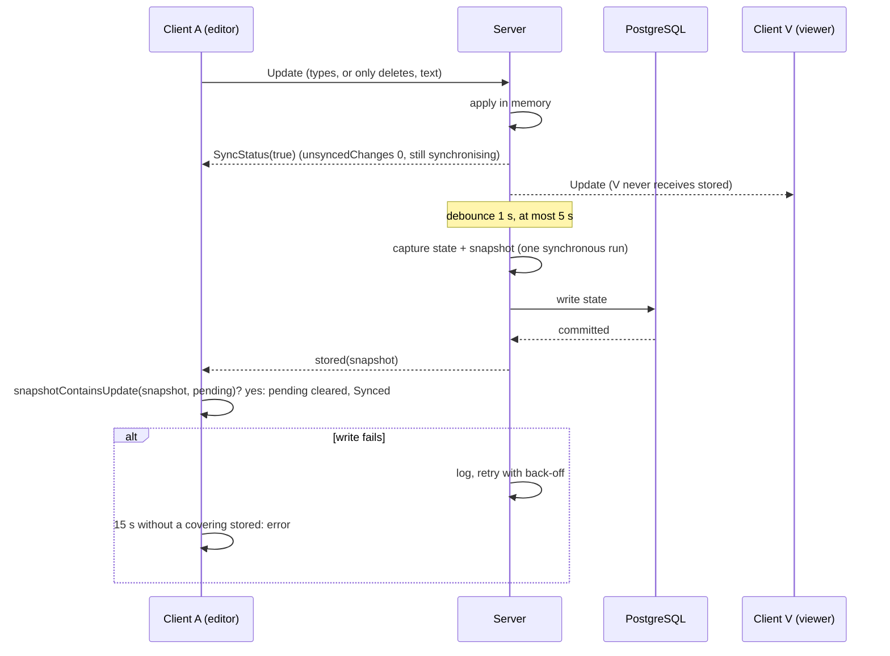

# Collaboration protocol

Normative. The collaboration server (T2.1), the client sync layer (T2.2), the offline cache (T2.3), comments (T3.x), access revocation (T4.1) and versions (T5.1) are built from this document. The wire vocabulary (names, codes, limits, message schemas, sync-state types) lives in [`packages/contract/src/collab.ts`](../../packages/contract/src/collab.ts), imported as `@draftroom/contract/collab`; this document says what it means and when it is used. **MUST**, **MUST NOT** and **MAY** are meant as in RFC 2119.

Pinned versions: `@hocuspocus/server` and `@hocuspocus/provider` 4.7.1, `yjs` 13.6.33, `@tiptap/y-tiptap` 3.x (Tiptap 3.31.4 depends on `^3.0.7`). Where this document cites "published source" it means the files inside those npm tarballs (`@hocuspocus/server@4.7.1` `src/ClientConnection.ts`, and so on), not the documentation site.

## 1. Facts this protocol is built on

Each fact was read in the published source, and the ones marked **tested** were also run.

| #   | Fact                                                                                                                                                                                                                                                                                                         | Where                                                                                                      |
| --- | ------------------------------------------------------------------------------------------------------------------------------------------------------------------------------------------------------------------------------------------------------------------------------------------------------------ | ---------------------------------------------------------------------------------------------------------- |
| F1  | The server answers every applied update with `SyncStatus(true)` right after applying it in memory. Nothing tells the client about a database write.                                                                                                                                                          | server `src/MessageReceiver.ts` (`messageYjsUpdate`)                                                       |
| F2  | A read-only connection never applies an update and answers `SyncStatus(false)` to each one. A SyncStep2 that adds nothing new is answered `SyncStatus(true)`. The provider ignores `false`, so its unsynced counter never returns to 0.                                                                       | server `src/MessageReceiver.ts`; provider `src/MessageReceiver.ts` (`applySyncStatusMessage`)              |
| F3  | The read-only flag is `data.connectionConfig.readOnly`, read after `onAuthenticate`. The provider reports it as `authorizedScope` `"readonly"` or `"read-write"`.                                                                                                                                            | server `src/ClientConnection.ts` (`createConnection`, `writeAuthenticated`); `src/OutgoingMessage.ts`      |
| F4  | `afterStoreDocument` exists and runs in the same `try` as `onStoreDocument`, so it runs only after a successful write. A failed write is logged, the document stays in memory, and nothing retries it until the next change.                                                                                 | server `src/Hocuspocus.ts` (`storeDocumentHooks`)                                                          |
| F5  | A failed authentication **does not close the WebSocket**. The server sends `PermissionDenied(reason)`, drops that document's state, and keeps the socket open. The hook payload has no handle to the socket.                                                                                                  | server `src/ClientConnection.ts` (`handleQueueingMessage`), `onAuthenticatePayload` in `src/types.ts`      |
| F6  | `Connection.close(event)` (and so `closeConnections`) does **not** close the WebSocket. It sends an in-band `CLOSE` message that carries only the reason text. The provider reports it as `{ code: 1000, reason }`, whatever the server passed, and does not reconnect.                                      | server `src/Connection.ts` (`close`); provider `src/MessageReceiver.ts` (`MessageType.CLOSE`)              |
| F7  | A message above `maxPayload` is refused by `ws` itself, which closes the socket with **1009**, before Hocuspocus sees it.                                                                                                                                                                                    | `ws@8.22.0` `lib/receiver.js` (`WS_ERR_UNSUPPORTED_MESSAGE_LENGTH`); server `src/Server.ts` (`websocketOptions`) |
| F8  | The hook that can change an awareness update before it is applied is `beforeHandleAwareness`: awaited, and it receives a mutable `states` map and a `removedClients` set. `onAwarenessUpdate` runs after the update is applied and is not awaited. Throwing from any message hook closes that connection.     | server `src/types.ts`, `src/MessageReceiver.ts` (`MessageType.Awareness`), `src/Connection.ts`             |
| F9  | The provider sends the token, SyncStep1 and any queued messages as soon as the socket opens, before authentication finishes. The server buffers them unapplied (`maxUnauthenticatedQueueSize`, `maxUnauthenticatedQueueMessages`, an absolute deadline of `timeout`) and drops the buffer if authentication fails. | server `src/ClientConnection.ts`; provider `src/HocuspocusProviderWebsocket.ts`                            |
| F10 | The provider's outbound queue is private, unbounded and flushed on every (re)connection. Only awareness messages are de-duplicated. More than `maxUnauthenticatedQueueMessages` messages before authentication make the server close the socket with 4205, and the provider would retry the same queue.     | provider `src/HocuspocusProviderWebsocket.ts` (`messageQueue`, `DEDUPLICATABLE_TYPES`)                    |
| F11 | **Tested.** A deletion-only edit does not change the state vector, because deleting adds no struct. A state vector therefore cannot show that a deletion was stored; a snapshot (state vector plus delete set) can (`Y.snapshotContainsUpdate`).                                                              | `yjs@13.6.33`; run in the scratchpad, see ADR 0006                                                         |
| F12 | `absolutePositionToRelativePosition(pos, fragment, mapping)` has no `assoc` parameter and uses `assoc = -1` for every text position. `relativePositionToAbsolutePosition(ydoc, fragment, relPos, mapping)` returns `null` when it cannot resolve.                                                            | `@tiptap/y-tiptap@3.0.10` `src/lib/utils/positions/`                                                       |
| F13 | **Tested.** Changing `assoc` on an existing relative position moves it by one character, so it cannot be flipped after creation. A relative position into deleted text resolves to the place of the deletion, not to `null`.                                                                                | `yjs@13.6.33` `src/utils/RelativePosition.js`                                                              |
| F14 | **Tested.** With `gc: true` (the Hocuspocus default), an update applied to nodes another transaction already deleted is integrated as deleted and its content is dropped: it is in no later state and in no version taken earlier.                                                                           | `yjs@13.6.33` `src/structs/Item.js`; ADR 0007                                                              |
| F15 | The collaboration undo manager tracks only transactions whose origin is `ySyncPluginKey` (plus any configured origin); remote and server-origin transactions are not tracked.                                                                                                                                | `@tiptap/y-tiptap@3.0.10` `src/lib/plugins/yUndoPlugin.ts`                                                 |

## 2. Document name

The name of a document on the wire is `doc:<documentId>`, built only with `documentName(documentId)` and read only with `parseDocumentName(name)`.

- `documentId` is the lowercase 8-4-4-4-12 hexadecimal form. Anything else is invalid: `documentName` throws, `parseDocumentName` returns `null`. Lowercase is mandatory because Hocuspocus keys its in-memory documents by name; two spellings of one id would become two documents that diverge.
- The document is the Yjs root fragment named `default` (`XmlFragment`), owned by `packages/editor-schema`. Title, folder and the other metadata are not in the Yjs document.
- One WebSocket carries **one** document. The client creates one `HocuspocusProvider` per open document, without a shared socket and with `sessionAwareness: false`. The server sets `maxPendingDocuments: 2` so a socket cannot fan out over many names.

## 3. Connection and authentication

### 3.1 Listener and configuration

Hocuspocus `Server` on `COLLAB_PORT`, with the options below. Values in capitals come from `@draftroom/contract/collab`.

| Option                                                  | Value                                                                                       |
| ------------------------------------------------------- | ------------------------------------------------------------------------------------------- |
| `websocketOptions.maxPayload`                           | `MAX_MESSAGE_BYTES` (2 MiB)                                                                 |
| `debounce`, `maxDebounce`                               | `STORE_DEBOUNCE_MS` (1 000), `STORE_MAX_DEBOUNCE_MS` (5 000)                                |
| `timeout`                                               | 30 000 ms (default). Also the absolute deadline for the first authentication (close `4408`). |
| `maxUnauthenticatedQueueSize`, `…QueueMessages`         | 256 KiB and 64. Legitimate traffic before authentication is SyncStep1 and awareness.        |
| `maxPendingDocuments`                                   | 2                                                                                           |
| `yDocOptions.gc`                                        | `true` (default). Versions are full updates because of it (§11).                            |

### 3.2 Upgrade

Before the WebSocket handshake, the `onUpgrade` hook checks `Origin` against `ALLOWED_ORIGINS`. A browser always sends it; a request without `Origin` is accepted only when `NODE_ENV` is `development` or `test`. A refused upgrade is answered `HTTP/1.1 403 Forbidden` on the raw socket, the socket is destroyed, and the hook then rejects with no error (`Server.ts` treats an empty rejection as handled). The session cookie is cross-site protected by `SameSite=Lax`; the check is defence in depth against sibling sites.

### 3.3 `onAuthenticate`, step by step

The identity is never taken from a token: the provider is created with `token: null`, and a server MUST ignore `data.token`. Nothing is read from the URL. The checks run in this order, and the first failure ends the process. A failure is `throw { reason }` with a plain object (no `message`, so the hook chain does not log it); the server answers `PermissionDenied(reason)`.

| #   | Check                                                                                                                                                                                       | Refusal reason    |
| --- | ------------------------------------------------------------------------------------------------------------------------------------------------------------------------------------------- | ----------------- |
| 1   | `parseDocumentName(data.documentName)` is not `null`. No database access has happened yet.                                                                                                   | `not-found`       |
| 2   | The `AuthProvider` boundary resolves an identity from `data.requestHeaders` (the session cookie; the development header only in `development` and `test`). The same function serves REST.   | `unauthenticated` |
| 3   | One query returns the person's effective role on the document (§4.3 of the plan). A missing document, a document in another workspace, no role, and an archived document the person does not own all give the same result and take the same path. | `not-found`       |
| 4   | The connection mode is decided (§4) and written to `data.connectionConfig.readOnly`.                                                                                                        | (never refuses)   |
| 5   | The hook returns `{ userId, workspaceId, role, displayName }`, which becomes the connection context.                                                                                        | (never refuses)   |

`not-found` stands for "missing" and "forbidden" alike, as REST does, so a document id cannot be probed. The reasons are exactly `authDeniedReasons`. `onLoadDocument` runs only after step 5 (Hocuspocus loads the document after authentication), so no document data is sent to a refused connection.

Because of F5, the server does not close the socket after a refusal. The client does: on `authenticationFailed` it calls `disconnect()` on its websocket provider. The deadline of F9 bounds a client that does not.



### 3.4 Refusing a second document name

A connection that authenticated one document and then sends messages for another goes through the same `onAuthenticate` for the new name; there is no shortcut. The client never does this.

## 4. Read-only mode by role

The mode is decided in `onAuthenticate` and enforced by Hocuspocus for the life of the connection.

| Effective role        | Document archived | `connectionConfig.readOnly` | `authorizedScope` |
| --------------------- | ----------------- | --------------------------- | ----------------- |
| `viewer`, `commenter` | no                | `true`                      | `readonly`        |
| `editor`, `owner`     | no                | `false`                     | `read-write`      |
| `owner`               | yes               | `true`                      | `readonly`        |

(An archived document is readable only by its owners; everyone else is refused with `not-found`.)

What a read-only connection does and does not do:

- It receives the document and every update, awareness and stateless event except `stored` (§7.2).
- A raw update or SyncStep2 it sends is **not applied, not stored and not broadcast** (F2). The server answers `SyncStatus(false)`; a hand-crafted update therefore changes nothing for anyone. T2.1 asserts this by behaviour (the update never appears in another client, in `document_states`, or in `onChange`), not by the name of the flag.
- It MAY send awareness (presence, carets), through the guard of §5.3. A commenter writes comments through REST, never through the document.
- The client never shows a read-only connection as unsynced (F2): the state is `read-only` and the unsynced counter is ignored (§8).
- A role change that flips the mode is applied at once, not at the next reconnection (§6.3).

## 5. Limits and protection of awareness

### 5.1 Limits

| Limit                                | Value                                              | Enforcement and outcome                                                                                                                                                                                                                                                                    |
| ------------------------------------ | -------------------------------------------------- | ------------------------------------------------------------------------------------------------------------------------------------------------------------------------------------------------------------------------------------------------------------------------------------------ |
| One message                          | `MAX_MESSAGE_BYTES` = 2 MiB                        | `maxPayload`. `ws` closes the socket with **1009** (F7), not 4413. The client treats 1009 as terminal "too large" and does not retry it: retrying would resend the same update.                                                                                                              |
| State of one document                | `MAX_DOCUMENT_STATE_BYTES` = 5 MiB                 | See §5.2. Reading stays possible; writes are refused with a stateless `document-too-large` and close `4413`.                                                                                                                                                                                |
| Messages per connection              | `MESSAGE_RATE_LIMIT_PER_SECOND` = 100, burst `MESSAGE_RATE_LIMIT_BURST` = 200 | A token bucket per connection, in `beforeHandleMessage`, one token per message of any type (awareness included). When empty: close `4429`, and throw so the message is not processed. The client reconnects with its normal back-off.                                       |
| Awareness state of one client        | `MAX_AWARENESS_STATE_BYTES` = 1 024 JSON bytes     | Dropped by the guard (§5.3).                                                                                                                                                                                                                                                                |
| Buffered before authentication       | 256 KiB, 64 messages, 30 s                         | F9. Exceeding the queue closes with `4205`; the deadline closes with `4408`.                                                                                                                                                                                                                |

The 5 MiB limit is soft by one store window: the size is the byte length of the state written by the last store (and of the state loaded at start). Writes arriving before the next measurement are bounded by the rate limit and `MAX_MESSAGE_BYTES`.

### 5.2 Refusing writes to an oversized document

In the `beforeSync` hook, for a SyncStep2 or Update message, when the last measured state exceeds `MAX_DOCUMENT_STATE_BYTES`, the server: (1) sends this connection the stateless event `document-too-large`; (2) closes its socket with `4413` (§6); (3) throws, so the message is not applied. Other connections are unaffected and keep reading. Closing, rather than silently dropping, is deliberate: a dropped update would be acknowledged with neither `SyncStatus(true)` nor an error and would leave the client "synchronising" forever.

### 5.3 Awareness guard

Presence is ephemeral and never used for authorisation. The guard is the `beforeHandleAwareness` hook (F8), which mutates the decoded update in place. It MUST NOT throw, because a throw closes the connection. For every entry of `states` (keyed by Yjs client id), in this order:

1. **Client id ownership.** The first connection that publishes an awareness client id owns it for the life of that connection; an entry for an id owned by another connection is deleted from `states`. A removal in `removedClients` is kept only for ids the connection owns (`removedClients.delete(id)` otherwise), so nobody can erase another person's presence.
2. **Size.** A state whose JSON is larger than `MAX_AWARENESS_STATE_BYTES` is deleted.
3. **Shape.** Only the keys `user` (`{ id, name, color }`) and `cursor` (what `CollaborationCaret` and the y-tiptap cursor plugin write) are kept; every other key is removed. `user.color` must match `^#[0-9a-fA-F]{6}$` (it is used in styles), otherwise the state is deleted.
4. **Identity.** `user.id` must equal the connection's `userId`, otherwise the state is deleted and never relayed. A matching state is rewritten with `user.name = displayName` from the connection context, so a client cannot show another name.

A client's own awareness is removed by Hocuspocus when its connection closes. `onAwarenessUpdate` is not a valid place for this guard (F8). T2.1 pins the hook with a test.

### 5.4 Stateless messages from clients

Clients never send stateless messages (comments and metadata go through REST). The `onStateless` hook ignores whatever arrives; the message still counts against the rate limit.

## 6. Close codes

### 6.1 Two ways to end a connection, and which one this protocol uses

Hocuspocus has two, and they are not equivalent (F5, F6):

- `Connection.close(event)` ends the **document** connection only: it sends an in-band message with the reason text, the provider reports code `1000`, the socket stays open and the provider does not reconnect. The numeric code is lost.
- Closing the **WebSocket** with a code and a reason reaches the browser as the standard close event, with the code intact. The provider then reconnects on its own unless told to stop.

Therefore: **the server ends a connection by closing its WebSocket**, `connection.webSocket.close(code, name)`, where `name` is the code's name from the table (the close reason is at most 123 bytes). It never uses `Connection.close` or `closeConnections` for the codes below. This is why §2 requires one socket per document. Authentication refusals are the one exception, because the hook cannot reach the socket (F5): they use `PermissionDenied` (§3.3), and the client closes.

### 6.2 Codes the Draftroom server sends

| Code   | Name                 | Sent when                                                                                                                                                             | Client reaction                                                                                                  |
| ------ | -------------------- | --------------------------------------------------------------------------------------------------------------------------------------------------------------------- | ---------------------------------------------------------------------------------------------------------------- |
| `4401` | `unauthenticated`    | The session of a live connection ended (sign-out, expiry), or the first frame is malformed (Hocuspocus does this itself).                                              | Terminal: `disconnect()`, state `error` (cause `unauthenticated`); the app asks the person to sign in.           |
| `4403` | `access-revoked`     | The person lost every role on the document, the document was deleted, or it was archived and the person is not an owner.                                                | Terminal: `disconnect()`, state `revoked`; purge the local copy; never upload.                                    |
| `4409` | `role-changed`       | The connection's mode no longer matches the person's role, or an owner's connection must be recycled after archive or restore-from-archive. "Reconnect to get the new mode." | Not terminal: the provider reconnects; authentication then decides `read-write` or `readonly`.                  |
| `4413` | `document-too-large` | A write was refused because the document is over `MAX_DOCUMENT_STATE_BYTES` (§5.2).                                                                                    | Terminal: `disconnect()`, state `error` (cause `document-too-large`).                                             |
| `4429` | `rate-limited`       | The per-connection rate limit was exceeded (§5.1).                                                                                                                     | Not terminal: the provider reconnects with its back-off (1 s doubling to 30 s, jittered).                         |

### 6.3 Closing a live connection: the procedure

Used by every case above, for the connections of the affected person (matched by `connection.context.userId`) on the affected document, or for all of them when the document itself changed:

1. Set `connection.readOnly = true` **synchronously**, before any `await`. From that instant the connection cannot write, even though the close frame is still on its way.
2. Send the stateless event that explains the change, if there is one (`access-changed`, `document-archived`). `ws` delivers frames in order, so the event arrives before the close.
3. `connection.webSocket.close(code, name)`.

Which event and code a change causes:

| Change                                                                 | Affected connections          | Stateless event       | Code   |
| ---------------------------------------------------------------------- | ----------------------------- | --------------------- | ------ |
| Member removed from the workspace                                      | that person, every document of the workspace | `access-changed`      | `4403` |
| Explicit grant removed or general access lowered, no role remains      | that person                   | `access-changed`      | `4403` |
| Role changed and the mode flips (editor to viewer, or the reverse)     | that person                   | `access-changed`      | `4409` |
| Role changed and the mode does not flip (editor to owner)              | none                          | `access-changed`      | none   |
| Document archived                                                      | non-owners                    | `document-archived`   | `4403` |
| Document archived                                                      | owners                        | `document-archived`   | `4409` |
| Document restored from the archive                                     | all                           | `access-changed`      | `4409` |
| Document deleted permanently                                           | all                           | none                  | `4403` |
| Session ended                                                          | every connection of the session | none                | `4401` |

### 6.4 Codes the transport and Hocuspocus emit

The client handles these too (`LIBRARY_CLOSE_CODES`):

| Code   | Name                 | Origin                                                       | Client reaction                                                                                          |
| ------ | -------------------- | ------------------------------------------------------------ | -------------------------------------------------------------------------------------------------------- |
| `1009` | `message-too-big`    | `ws`, message above `maxPayload` (F7)                        | Same as `4413`: terminal, `error` with cause `document-too-large`.                                       |
| `4205` | `connection-reset`   | Hocuspocus: unauthenticated queue limits (F9, F10)           | Reconnect. The client MUST avoid the cause (§12.3).                                                       |
| `4408` | `connection-timeout` | Hocuspocus: idle or unauthenticated deadline; also the provider's own forced close | Reconnect.                                                                       |

Any other code, and `null` (the browser reports none), is treated as a lost connection.

## 7. Durable acknowledgement

"Synced" means the server **stored** the change durably. The in-memory acknowledgement (`SyncStatus(true)`, F1) is not enough.

### 7.1 Why the plan's state-vector rule is replaced

The plan (§5.2) has the server send the state vector of what it wrote, and the client show Synced when that vector covers its own clock. F11 shows the rule is unsound: a deletion-only edit leaves every clock unchanged, so any `stored` message "covers" it, whether or not the deletion was written. The `stored` event carries a **snapshot** instead (state vector and delete set), and the client checks that the snapshot contains its pending changes. The format of the vector is the one `Y.encodeStateVector` writes (V1), inside the snapshot.

### 7.2 Server

Both hooks run inside the document's store mutex, so the pair is atomic with respect to other stores and to a restore (§11).

1. **`onStoreDocument`**, in one synchronous run with no `await` between the three lines:
   `state = Y.encodeStateAsUpdate(document)`; `snapshot = Y.encodeSnapshot(Y.snapshot(document))`; `size = state.byteLength`. Then it writes `state` to `document_states.state` (and records `size`, §5.1) and keeps `snapshot` in a per-document slot.
2. **`afterStoreDocument`** broadcasts `{ "type": "stored", "snapshot": <base64 of the slot> }` with `document.broadcastStateless(serializeStatelessEvent(event), (connection) => !connection.readOnly)`: only to writable connections. It MUST send the snapshot captured in step 1 and MUST NOT compute a new one: an update applied while the write was in flight is acknowledged to its author but not yet stored, and recomputing would claim it was.
3. A failed write sends nothing (F4). The server MUST also retry it without waiting for another change: after a failure it schedules `instance.storeDocumentHooks(document, payload, true)` with back-off 1 s, 2 s, 4 s, up to 30 s, until it succeeds or the document is unloaded. Hocuspocus does not do this itself (F4).
4. Shutdown stores every pending document (`flushPendingStores()` before `destroy()`), so a restart loses no acknowledged change.

### 7.3 Server: the snapshot a new connection gets

A client that reopens a document with a local copy has nothing new to send; the server then applies nothing, stores nothing, and would never send `stored`. So the `connected` hook sends each **writable** connection `stored` with the snapshot of the **last stored state**: the slot of §7.2, or, for a document just loaded from the database, the snapshot of the loaded state (everything loaded is stored by definition). It is never a snapshot of unstored memory.

### 7.4 Client: the rule

The client keeps one value, `pending`: a Yjs update, or nothing.

- Every change made by this client is merged into `pending` with `Y.mergeUpdates` (a change is a document update whose origin is neither the provider nor the local cache).
- On open, when a local copy exists, **all of its content** is `pending` until proven stored. (The client cannot tell which part of an offline copy the server already has.)
- On a `stored` event the client decodes `snapshot` (base64 to bytes, `Y.decodeSnapshot`). If `pending` is nothing, or `Y.snapshotContainsUpdate(snapshot, pending)` is true, `pending` becomes nothing and the event is delivered to the state machine as `{ type: 'stored', coversLocalChanges: true }`; otherwise `pending` is kept and `coversLocalChanges` is `false`. Containment checks every struct clock and every deleted range of `pending`.
- `pending` survives reconnections. It is dropped only by the purge of §12.

**The client shows Synced if and only if all of these hold:** the scope is `read-write`; the handshake of the current connection completed (`synced`); the provider's `unsyncedChanges` is `0`; and `pending` is nothing. Order does not matter: a `stored` that arrives before the provider's acknowledgement is remembered, and the state turns `synced` when the last condition becomes true.

### 7.5 Client: timeout

When `unsyncedChanges` is `0` and `pending` is not nothing, a timer of `STORED_ACK_TIMEOUT_MS` (15 s) runs. It restarts on each local change, stops when `pending` clears or the connection drops, and starts again after a reconnection. When it fires the machine receives `stored-ack-timeout` and shows `error`, never `synced`.



## 8. Client sync-state machine

The machine is implemented by T2.2; its types are `SyncState`, `SyncEvent` and `SyncErrorCause` in `collab.ts`. Beyond the state it tracks these facts: `scope`, `handshakeDone`, `unsyncedChanges`, `pending` (§7.4), `online`, `hasBeenAuthorized` (true once this editor session, or the local copy, was authorised).

### 8.1 States

| State           | Meaning                                                                                                                       | Shown as                           |
| --------------- | ----------------------------------------------------------------------------------------------------------------------------- | ---------------------------------- |
| `connecting`    | Opening and authenticating for the first time in this session.                                                                | loading                            |
| `synchronising` | Authorised read-write; the handshake is running, or changes are not yet stored.                                               | Synchronising                      |
| `synced`        | The rule of §7.4 holds.                                                                                                       | Synced                             |
| `offline-local` | No connection and the browser is offline. Changes are kept in the local copy, not on the server.                              | Offline with local copy            |
| `reconnecting`  | No connection but the browser is online (server unreachable or restarting). Retrying.                                         | Reconnecting                       |
| `error`         | Recoverable problem; a retry is offered. Carries a `SyncErrorCause`.                                                          | Error                              |
| `revoked`       | Access was removed. Terminal for this editor session.                                                                         | Access removed                     |
| `read-only`     | Authorised read-only, including archived documents. Never unsynced.                                                           | Read-only                          |

### 8.2 Transitions

"Settle" means: if the guard of §7.4 holds, go to `synced`, else stay in `synchronising`. An event not listed for a state is ignored in that state. `revoked` ignores everything.

| Event                                             | From                                                                 | Guard or detail                                         | To                                                                                   |
| ------------------------------------------------- | -------------------------------------------------------------------- | ------------------------------------------------------- | ------------------------------------------------------------------------------------ |
| `open`                                            | initial                                                              |                                                         | `connecting`                                                                         |
| `open` (retry)                                    | `error`                                                              | reopen the provider                                     | `connecting`                                                                         |
| `authenticated`                                   | `connecting`, `reconnecting`, `offline-local`                        | `scope = 'read-write'`                                  | `synchronising`, then settle                                                         |
| `authenticated`                                   | `connecting`, `reconnecting`, `offline-local`                        | `scope = 'readonly'`                                    | `read-only` (§12.4 if changes were pending)                                          |
| `authentication-denied`                           | `connecting`, `reconnecting`, `offline-local`                        | `reason = 'unauthenticated'`                            | `error` (cause `unauthenticated`)                                                    |
| `authentication-denied`                           | same                                                                 | `reason = 'not-found'` and `hasBeenAuthorized`          | `revoked`                                                                            |
| `authentication-denied`                           | same                                                                 | `reason = 'not-found'` and not `hasBeenAuthorized`      | `error` (cause `not-found`)                                                          |
| `handshake-completed`                             | `synchronising`                                                      |                                                         | settle                                                                               |
| `local-change`                                    | `synced`                                                             | `pending` becomes set                                   | `synchronising`                                                                      |
| `local-change`                                    | `synchronising`, `reconnecting`, `offline-local`                     | recorded in `pending`                                   | same state                                                                           |
| `unsynced-changes-changed`                        | `synced`                                                             | `count > 0`                                             | `synchronising`                                                                      |
| `unsynced-changes-changed`                        | `synchronising`                                                      |                                                         | settle                                                                               |
| `stored`                                          | `synchronising`                                                      | `coversLocalChanges`                                    | settle                                                                               |
| `stored`                                          | `synchronising`                                                      | not `coversLocalChanges`                                | same state                                                                           |
| `stored-ack-timeout`                              | `synchronising`                                                      |                                                         | `error` (cause `store-timeout`)                                                      |
| `document-too-large`                              | `synchronising`, `synced`                                            |                                                         | `error` (cause `document-too-large`); stop reconnecting                              |
| `connection-closed`                               | any live state                                                       | `code = 4403`                                           | `revoked`                                                                            |
| `connection-closed`                               | any live state                                                       | `code = 4401`                                           | `error` (cause `unauthenticated`)                                                    |
| `connection-closed`                               | any live state                                                       | `code = 4413` or `1009`                                 | `error` (cause `document-too-large`)                                                 |
| `connection-closed`                               | `synchronising`, `synced`, `read-only`, `reconnecting`               | any other code or `null`, `online`                      | `reconnecting`                                                                       |
| `connection-closed`                               | the same, and `connecting`, `offline-local`                          | any other code or `null`, not `online`                  | `offline-local`                                                                      |
| `connection-closed`                               | `connecting`                                                         | any other code or `null`, `online`                      | `connecting`                                                                         |
| `network-changed`                                 | `synchronising`, `synced`, `read-only`, `reconnecting`               | `online = false`                                        | `offline-local`                                                                      |
| `network-changed`                                 | `offline-local`                                                      | `online = true`                                         | `reconnecting`                                                                       |

The "live states" are `connecting`, `synchronising`, `synced`, `read-only`, `reconnecting` and `offline-local`. `error` ignores `connection-closed` and `network-changed` until the next `open`.

### 8.3 Cases the T2.2 table MUST contain

| Case                                                                       | Expected                                                                                                   |
| -------------------------------------------------------------------------- | ---------------------------------------------------------------------------------------------------------- |
| `stored` arrives before the provider's acknowledgement                     | stays `synchronising`; becomes `synced` when the count reaches 0                                           |
| A write fails: no covering `stored` for 15 s                               | `error` (`store-timeout`); never `synced`                                                                  |
| A second local change while the timer runs                                 | the timer restarts; `pending` includes both                                                                |
| A deletion-only change followed by a `stored` taken before it              | not covered: stays `synchronising`                                                                         |
| A `stored` whose snapshot contains the change                              | `synced`                                                                                                   |
| A viewer or commenter: the provider's counter stays above 0                | `read-only`, never `synchronising`                                                                         |
| Connection lost with pending changes, browser offline / online             | `offline-local` / `reconnecting`; `pending` kept; after reconnection `synchronising`, then `synced` only after a covering `stored` |
| Reconnection authorised as `readonly` after offline edits                  | `read-only` and the discard of §12.4                                                                       |
| Close `4403`, or `not-found` on re-authentication of a known document      | `revoked`; no upload                                                                                       |

### 8.4 Effects

Entering `revoked` purges the local copy and never uploads (§12). Entering `error` with cause `document-too-large`, `unauthenticated` or `not-found` calls `disconnect()` so the provider stops retrying. Announcing a state in a live region is done once per change of state, never per keystroke.

## 9. Stateless events

Server to client only, on the stateless channel of the document, as JSON validated by `statelessEventSchema`. Serialise with `serializeStatelessEvent`, read with `parseStatelessEvent`, which returns `null` for anything malformed or unknown: a client ignores it and never fails because of it. Every event goes to all connections of the document unless stated, so a payload MUST hold nothing a viewer is not allowed to read.

| Type                 | Payload                         | Recipients                 | Emitted by and when                                                       | Client reaction                                                                        |
| -------------------- | ------------------------------- | -------------------------- | ------------------------------------------------------------------------- | -------------------------------------------------------------------------------------- |
| `stored`             | `snapshot` (base64)             | writable connections       | after each durable write (§7.2), and on connection (§7.3)                 | the rule of §7.4                                                                       |
| `metadata-changed`   | `title`, `revision`             | all                        | after a committed `PATCH /documents/{id}` (T1.1)                          | update the title field unless the person is editing it; invalidate the document query. `revision` lets a stale local edit see the conflict. |
| `access-changed`     | none                            | all                        | after any access or general-access change (T4.1), before the closes of §6.3 | invalidate the access and the shared-with-me queries                                   |
| `comments-changed`   | `threadId`                      | all                        | after any thread action committed (T3.1)                                  | invalidate the threads query and that thread                                           |
| `versions-changed`   | none                            | all                        | after a version is created or restored (T5.1)                             | invalidate the versions query; the editor shows that a restore happened if one did     |
| `document-archived`  | none                            | all                        | after archive (T1.1), before the closes of §6.3                           | show the archived state; the connection is recycled                                    |
| `document-too-large` | none                            | the refused connection     | when a write is refused (§5.2)                                            | machine event `document-too-large`                                                     |

Only `stored` and `document-too-large` are machine events; the others only invalidate queries. Clients never send stateless messages (§5.4).

## 10. Comment anchors

### 10.1 Format

A thread anchors a range with `anchor = { start, end }` (`anchorSchema`) and the `quote` (`quoteSchema`):

- `start` and `end` are the standard base64 (with padding) of `Y.encodeRelativePosition(...)`, at most `MAX_ANCHOR_POSITION_LENGTH` (128) characters each.
- `quote` is the text the range covered when the thread was created, at most `MAX_QUOTE_LENGTH` (500) **Unicode code points** (not UTF-16 units: the REST contract counts code points). A longer selection is cut at a code-point boundary before sending.
- The server stores and returns both as opaque values. It validates only the shape and never decodes a position.

### 10.2 Creation

On the client, from the editor selection `from`/`to` (ProseMirror positions), with the sync binding's `mapping` (`ySyncPluginKey.getState(view.state).binding.mapping`):

```ts
import { absolutePositionToRelativePosition } from '@tiptap/y-tiptap'
import * as Y from 'yjs'

const encode = (position: number) =>
  toBase64(Y.encodeRelativePosition(absolutePositionToRelativePosition(position, fragment, mapping)))
const anchor = { start: encode(from), end: encode(to) }
```

The helper comes from `@tiptap/y-tiptap`, never from `y-prosemirror` (the two must not be mixed). **Deviation from the plan:** the plan asks for `assoc = 0` at the start and `-1` at the end. The helper has no such parameter and uses `-1` for every text position (F12), and a position cannot be re-associated afterwards (F13). So both ends use `assoc = -1`: the range follows the character on its left. Observable consequence (tested in Yjs): text typed exactly at the start boundary falls **inside** the range, and text typed exactly at the end boundary falls outside. T3.2 pins this in its "inserts before, inside and after" tests. No client may change `assoc` after creation.

### 10.3 Resolution

On the client, with the live `Y.Doc`, the fragment and the mapping:

1. Decode both ends with `Y.decodeRelativePosition`. A value that does not decode makes the thread **orphaned**.
2. `relativePositionToAbsolutePosition(ydoc, fragment, relativePosition, mapping)` for each end.
3. The thread is **orphaned** when either end resolves to `null`, or when `start >= end`.
4. Until the first handshake of the session completes (`handshake-completed`), threads are *unresolved*: listed without a highlight and **not** marked orphaned, so a document that is still loading never flashes orphans.

Notes: a relative position into deleted text resolves to where the deletion happened rather than to `null` (F13), so deleting a whole range collapses it to one point (`start >= end`, orphaned), and deleting half of it leaves the surviving part. A restore (§11) orphans threads whose text it removed and keeps those on text it kept.

### 10.4 Behaviour of an orphaned thread

It stays in the list with its `quote`, can be replied to and resolved, and has no highlight. Highlights are ProseMirror decorations computed from resolved anchors, never marks in the Yjs document, so a commenter (read-only on content) can still comment. Resolution is recomputed when the Yjs document changes, for the open threads only. Re-anchoring is out of scope.

## 11. Versions and restore

### 11.1 What a version is

A full `Y.encodeStateAsUpdate(doc)` (V1) of the document, stored in `document_versions.state` with `createdBy`, `kind` (`auto`, `manual`, `pre-restore`, `restore`) and `label`. It is a full update, not a Yjs snapshot, because `Y.createDocFromSnapshot` needs `gc: false` and the server runs with `gc: true`. Versions are independent: deleting one never affects another. Retention is unlimited for now.

### 11.2 Automatic versions

Constants `AUTO_VERSION_IDLE_MS` (10 minutes) and `AUTO_VERSION_MIN_INTERVAL_MS` (30 minutes). The server creates an `auto` version, by the system (no `createdBy`), when **all** hold:

- the document has been idle for 10 minutes, meaning no update was applied for 10 minutes;
- there are edits since the newest version of any kind (the document's snapshot differs from that version's, `Y.equalSnapshots`);
- the newest **auto** version is at least 30 minutes old. If the first two hold but this one does not, the version is created at `newest auto + 30 minutes` provided no edit arrives before then (an edit restarts the idle clock). The version is deferred, not skipped, so edits never stay unversioned indefinitely.

It is taken from the live document under the store mutex when the document is loaded, and from the stored state when it is not, so a document everybody closed still gets its version. The timestamps this needs are persisted; T5.1 chooses the mechanism. After creation the server broadcasts `versions-changed`.

### 11.3 Manual versions and preview

Editors and owners create a manual version with an optional label (`POST /api/documents/{id}/versions`), taken from the live document under the store mutex; `versions-changed` follows. Everyone who can read the document can list and preview versions. A preview downloads the update (`GET /api/versions/{id}/content`), applies it to a fresh `Y.Doc` and renders it in a read-only editor; a preview never opens a provider and never touches the live document.

### 11.4 Restore (owner only)

The server-side sequence for `POST /api/versions/{versionId}/restore`. "Mutex" is the document's `saveMutex`, the one Hocuspocus holds around a store.

| #   | Step                                                                                                                                                                                                                                                                                                                                                                  | Mutex held |
| --- | --------------------------------------------------------------------------------------------------------------------------------------------------------------------------------------------------------------------------------------------------------------------------------------------------------------------------------------------------------------------------- | ---------- |
| 1   | Authorise: owner of the document, which is not archived; the version belongs to the document. Otherwise `404` or `403` as the access matrix says.                                                                                                                                                                                                                      | no         |
| 2   | Read the version's update and convert it with `yUpdateToJson` in a throwaway `Y.Doc`; validate the JSON against the editor schema. Failure ends here: nothing has touched the live document.                                                                                                                                                                          | no         |
| 3   | Open the live document (`openDirectConnection`, which loads it when nobody is connected). Acquire the mutex. This waits for a store in flight and makes later stores wait.                                                                                                                                                                                              | acquires   |
| 4   | Capture `pre = Y.encodeStateAsUpdate(live)` and `preSnapshot = Y.snapshot(live)`. In the database insert the `pre-restore` version from `pre`. This `await` is the only one before the change.                                                                                                                                                                       | yes        |
| 5   | **Verify and apply, in one synchronous run:** if `Y.equalSnapshots(Y.snapshot(live), preSnapshot)` is false (an edit arrived during step 4), do not apply: go back to step 4 with a fresh capture, at most 3 times, then fail with `409 conflict`. If it is true, `live.transact(() => replace the fragment content with the converted JSON, 'restore')`, then `post = Y.encodeStateAsUpdate(live)`. | yes        |
| 6   | In **one database transaction**: insert the `restore` version from `post`, insert the activity event, and write the document state with the same capture-and-write function the store hook uses (§7.2). Commit. On failure retry it (idempotent by restore request id) up to 3 times; the content is already restored in memory and the store retry of §7.2 persists it.     | yes        |
| 7   | Release the mutex; broadcast `versions-changed`; answer the request. Connected editors have already received the change as a normal update (origin `restore`).                                                                                                                                                                                                       | released   |

```mermaid
sequenceDiagram
    participant O as Owner (REST)
    participant S as Server
    participant L as Live Y.Doc + store mutex
    participant DB as PostgreSQL
    participant E as Connected editors
    O->>S: POST /versions/{id}/restore
    S->>DB: read version, convert to JSON (no live access)
    S->>L: acquire mutex (waits for a store in flight)
    S->>L: capture pre + snapshot
    S->>DB: insert pre-restore version(pre)
    S->>L: snapshot unchanged? (else recapture, max 3)
    S->>L: transact 'restore': replace content; capture post
    L-->>E: normal update broadcast
    S->>DB: one transaction: restore version(post), activity, document state
    S->>L: release mutex
    S-->>E: versions-changed
    S-->>O: 200
```

**Why the shape.** The check and the change in step 5 are one synchronous run, so no edit can slip between "the state I saved as `pre-restore`" and "the state I replace": the `pre-restore` version is exactly what was replaced. The mutex is what keeps a store that captured the old state from writing it **after** the restore's write and bringing the old content back. Two restores, a restore and a version, and a restore and a store are serialised by the same mutex.

**What is and is not guaranteed.**

- Everything applied before step 5 is in `pre-restore`. Edits sent after the clients receive the restore apply on top of it by CRDT rules.
- The content is replaced by **diffing** against the live fragment (y-tiptap `updateYFragment`), not by deleting everything and re-inserting, so nodes the restore keeps keep their identity: concurrent edits and comment anchors on them survive. T5.1 verifies the exports against the installed version.
- **Known limit (F14).** An edit that was already in flight when the restore applied and that targets nodes the restore removed is integrated as deleted and is not recoverable: it is in no state and in no version. The window is the network latency of that edit. The plan's wording ("never discarded silently, because the pre-restore version keeps the previous state") holds only for edits applied before step 5. Mitigations: the diff keeps unchanged nodes; `versions-changed` lets every client say that a restore happened. ADR 0007 records the alternatives.
- Undo in other clients is not affected (§13). Threads on removed text become orphaned (§10.3). Presence is unaffected.

## 12. Offline cache and revocation

### 12.1 The local copy

`y-indexeddb` keeps one copy per account, workspace and document under the name `draftroom:<userId>:<workspaceId>:<documentId>`, only for documents the person opened (offline editing of a never-opened document is out of scope). An offline copy is `offline-local` and never "Saved".

### 12.2 Purges

| Event                                          | Purge                                                              |
| ---------------------------------------------- | ------------------------------------------------------------------ |
| State `revoked` (close `4403`, or `not-found` on re-authentication of a known document) | that document's copy                      |
| Sign-out                                       | every copy whose name starts with `draftroom:<userId>:`            |
| Account switch                                 | every copy of the previous account                                 |

### 12.3 No pre-authentication backlog

By F9 and F10 the provider flushes everything it queued while offline the instant the socket opens, before the server has authenticated anything, and the queue is private and unbounded. An offline stretch of a few hundred edits would exceed the 64-message limit of §5.1, the server would close with `4205`, and the provider would resend the same queue forever. The client MUST therefore prevent offline edits from accumulating in the transport queue: while the connection is down the provider must not enqueue document updates, because the reconnection handshake (SyncStep1 and SyncStep2 by state vector) resends every change anyway. The mechanism (for example detaching the provider while disconnected) belongs to T2.2 and is pinned by a test with 2 000 offline edits followed by a reconnection that completes. The server keeps its small limits.

### 12.4 Re-authentication after an outage

Nothing is applied before authentication finishes (F9), so a refusal or a downgrade cannot upload anything. On reconnection:

| Outcome                                                         | Client                                                                                                                                                                                                                                 |
| --------------------------------------------------------------- | -------------------------------------------------------------------------------------------------------------------------------------------------------------------------------------------------------------------------------------- |
| Authorised `read-write`                                         | handshake; offline edits reach the server; `synchronising`, then `synced` after a covering `stored`.                                                                                                                                    |
| `PermissionDenied` `not-found` for a document that was open (or has a local copy), or close `4403` | `revoked`: purge the copy, discard the in-memory document, show that access was removed. Nothing is uploaded.                                                         |
| Authorised `readonly` while `pending` is not nothing (downgrade)  | **`read-only`, not `revoked`**: the person can still read. The offline changes are not uploaded (the server refuses them, F2): the client purges the copy, destroys the document and provider, and reopens from the server state, then tells the person the offline changes were not saved. **Deviation from the plan,** which says `revoked` here; telling someone with read access that access was removed would be false. |

A removed account's `PermissionDenied` is `not-found`, never a distinct "forbidden" (§3.3), so the client treats `not-found` after a prior authorisation as removal.

## 13. Undo

`StarterKit.configure({ undoRedo: false })`, with the Collaboration extension's undo. Its undo manager tracks only transactions with the local sync origin (F15), so `Mod-Z` reverts only the person's own edits. Remote edits and a restore (origin `restore`) are never tracked, so nobody can undo someone else's work or a restore. The protocol does not clear the undo stack after a restore: an entry whose content the restore removed has nothing to act on, and an entry may re-insert the person's own earlier deletion if its container still exists.

## 14. Decisions this document makes where the plan was silent or wrong

| Topic                              | Decision                                                                                                       | Why                                                              |
| ---------------------------------- | -------------------------------------------------------------------------------------------------------------- | ---------------------------------------------------------------- |
| `stored` payload                   | a snapshot instead of a state vector (§7)                                                                       | F11                                                              |
| Closing a connection               | close the WebSocket, one per document, flip `readOnly` first (§6)                                                | F5, F6                                                           |
| Oversize message                   | transport close `1009`, handled like `4413` (§5.1)                                                              | F7                                                               |
| Authentication refusal reasons     | `unauthenticated` and `not-found` only (§3.3)                                                                   | no id probing                                                    |
| Connection context                 | `{ userId, workspaceId, role, displayName }`                                                                    | awareness name rewrite (§5.3)                                    |
| `stored` on connection             | send the last stored snapshot (§7.3)                                                                            | a reopen with nothing new would never become Synced              |
| Failed store                       | the server retries with back-off (§7.2)                                                                         | F4                                                               |
| Anchor `assoc`                     | `-1` at both ends (§10.2)                                                                                       | F12, F13                                                         |
| Quote and title length             | counted in Unicode code points                                                                                  | match JSON Schema `maxLength`                                    |
| Restore                            | persist `pre-restore` first, verify and apply synchronously, hold the store mutex until committed (§11.4)       | exact `pre-restore`, no regression of the stored state           |
| Downgrade after offline edits      | `read-only` with a notice, not `revoked` (§12.4)                                                                 | the person still has read access                                 |
| Pre-authentication backlog         | the client must not queue offline edits (§12.3)                                                                  | F10                                                              |
